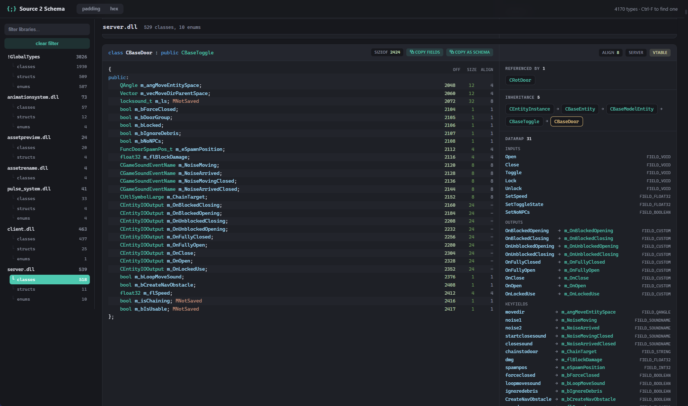

# source2_dumper

**Live site: [boeing666.github.io/source2-dumper](https://boeing666.github.io/source2-dumper/)**

Offline schema dumper for Source 2 (CS2), for **Windows (`.dll`) and Linux (`.so`)**
binaries. Loads the game binaries **without running the game**, pulls every registered
class/enum from `SchemaSystem`, and emits a single browsable reference page — every type
as C++-like code, with offsets, sizes, datamap, inheritance and cross-references.
Auto-updates each game patch via GitHub Actions.

## Example output



Per class: fields with `offset / size / align` (toggle hex or dec), the `m_pDataMap`
(inputs / outputs / keyfields → members), full inheritance chain, referenced-by, and
copy-as-schema. Filter by library, Ctrl-F any type, deep-link any field.

## Build

```
git clone --recursive --depth 1 https://github.com/Wend4r/sourcesdk thirdparty/sourcesdk
git clone --recursive --depth 1 https://github.com/Wend4r/cpp-dynlibutils thirdparty/cpp-dynlibutils
git clone --recursive --depth 1 --branch v4.1.0 https://github.com/zyantific/zydis thirdparty/zydis

cmake -B build -G Ninja -DCMAKE_BUILD_TYPE=Release
cmake --build build
```

## Run

The game files come from Steam through [SteamFileDownloader](https://github.com/SteamTracking/SteamFileDownloader):
the binaries, `steam.inf` and only the VPK chunks holding the `.gameevents` (a few MB instead of the game content).
Build it once into `.tools/steamfiledownloader` (.NET 10 SDK):

```
git clone https://github.com/SteamTracking/SteamFileDownloader .tools/sfd-src
dotnet publish .tools/sfd-src/SteamFileDownloader.csproj -c Release -r win-x64 -o .tools/steamfiledownloader   # or linux-x64
```

cs2 downloads anonymously. dota2 content and deadlock need an account that has the game: save a login once
with `.tools/steamfiledownloader/SteamFileDownloader login` (QR code from the Steam app). Then download and dump:

```
GAME=cs2 bash scripts/download-depots.sh   # windows | linux | both; scripts\download-depots.ps1 -Game cs2 on Windows
build/source2_dumper out                   # -> out/<game>/<platform>/*.json
```

CI ([`schema-site.yml`](.github/workflows/schema-site.yml)) polls each game's Steam build id every 10 minutes
(`scripts/game-version.sh`) and, on a new build, dumps every game on a Windows and a Linux runner and publishes
the site to GitHub Pages. It logs in with the `STEAM_USERNAME` / `STEAM_PASSWORD` secrets (Steam Guard off).

## MCP server

[`mcp/`](mcp/README.md) is a remote MCP server (Vercel, free Hobby plan) over the published dumps, so assistants
can query schema offsets, convars, commands, events and the VScript API for every game and platform directly.

## License

- **Source code** (dumper, generator, scripts) — [MIT](LICENSE).
- **Generated dumps & the website** (per-class pages, index, layout) — [CC BY 4.0](https://creativecommons.org/licenses/by/4.0/): reuse freely, but **credit `boeing666/source2-dumper` and link back** to this repo.

The underlying schema facts belong to Counter-Strike 2 / Valve; this project claims no rights over them.
